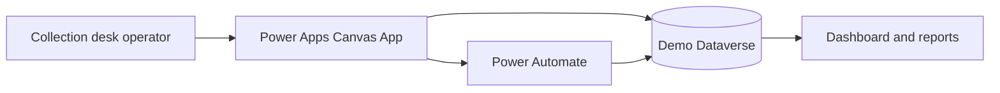

# Architecture — Independent Demo

The design is conceptual and does not use a corporate tenant, exported app, or production connections.

## Components

- **Power Apps**: receiving, search, pickup and confirmation screens.
- **Dataverse**: fictional orders and pickup events.
- **Power Automate**: optional pickup-event orchestration.
- **Reports**: operational counts and date filtering.

For production, apply role-based access, audit retention, server-side validation, error handling, and appropriate privacy controls for signatures.
